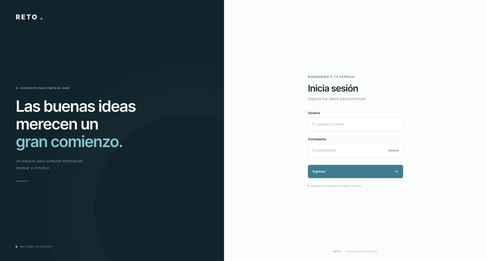
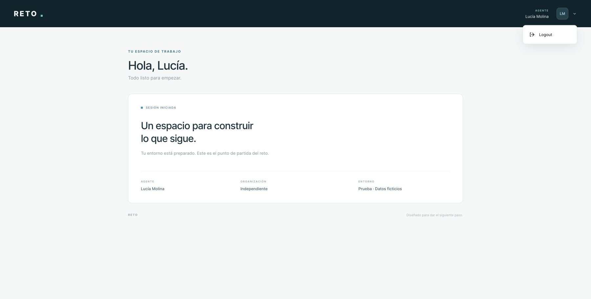

# RETO

Aplicación inicial del reto: frontend React y TypeScript, API Fastify y TypeScript,
y PostgreSQL 16. La interfaz conserva la paleta azul petróleo de PBG Copilot,
usa únicamente la palabra RETO y muestra el nombre del agente conectado. El menú
de cuenta contiene una sola opción: Logout.





## Iniciar

Requisitos: Docker Engine o Docker Desktop con Docker Compose v2.

```sh
docker compose up -d --build
```

El backend crea el esquema y carga automáticamente `data/seed.json.gz` en la primera
ejecución. La carga es transaccional e idempotente: reiniciar conserva los datos,
las sesiones y cualquier cambio local. Un volumen nombrado mantiene PostgreSQL.
No se requiere acceso a AWS para levantar el reto.

| Servicio | Dirección |
| --- | --- |
| Aplicación | http://localhost:8088 |
| API | http://localhost:8008 |
| Health | http://localhost:8008/health |
| PostgreSQL | localhost:5439, base `reto`, usuario `reto`, contraseña `reto_local_only` |

Los puertos están limitados a loopback. `.env.example` permite cambiarlos. Si se
cambia el puerto web o se usa otro host, actualizar también `APP_ORIGIN`.

**Usuario de ejemplo:** `agente001` o `agente001@reto.example`.
**Contraseña de TODOS los usuarios de prueba:** `123456`, por indicación de Abel.
Las contraseñas originales y sus hashes nunca se importan. La aplicación almacena
el hash scrypt de la contraseña local. Estas credenciales son exclusivamente de
demostración y no corresponden a ninguna cuenta de producción.

```sh
docker compose ps
docker compose logs backend
docker compose exec postgres psql -U reto -d reto -c 'SELECT username, name, email FROM reto.agents ORDER BY username;'
docker compose stop
```

## API

### `GET /health`

Consulta PostgreSQL antes de responder. Devuelve 200 con
`{"status":"ok","service":"reto-api","database":"ok"}` o 503 si la base falla.

### `POST /auth/get-toke`

La ruta conserva exactamente el nombre solicitado, `get-toke`.

```sh
curl -s http://localhost:8008/auth/get-toke \
  -H 'Content-Type: application/json' \
  -d '{"usuario":"agente001","contrasena":"123456"}'
```

Devuelve `token`, `token_type: "Bearer"`, `expires_in` y `agent`. Usuario acepta
el alias o el correo ficticio. Las credenciales incorrectas devuelven 401 sin
indicar si el usuario existe; un cuerpo inválido devuelve 400 y los intentos
excesivos reciben 429.

El token es aleatorio y opaco. Solo su SHA256 se guarda en PostgreSQL. Una sesión
activa por agente; iniciar otra revoca el token previo. Vence a las ocho horas
por defecto. La expiración se verifica en el servidor.

### `GET /auth/me`

```sh
curl http://localhost:8008/auth/me -H 'Authorization: Bearer TU_TOKEN'
```

Devuelve el agente de la sesión. Sin un token válido responde 401. El frontend
usa la cookie HttpOnly y SameSite que establece el login; no guarda el token en
localStorage ni sessionStorage. Al abrir o recargar la web comprueba la sesión.

### `POST /auth/logout`

Revoca el token en PostgreSQL y elimina la cookie. Responde 204. Los cambios
desde un origen de navegador distinto de `APP_ORIGIN` se rechazan.

## Datos incluidos

La semilla deriva del respaldo existente de PostgreSQL de AWS del 20 de octubre
de 2026, comprobado por SHA256. Esa base AWS es una copia de PBG Copilot con su
propia fecha de corte, no una réplica continua del origen. `data/manifest.json`
registra la procedencia, los conteos y el checksum del archivo distribuido.

| Tabla local | Contenido |
| --- | --- |
| `reto.agencies` | 5 agencias ficticias |
| `reto.agents` | 107 usuarios con identidad ficticia y contraseña local |
| `reto.clients` | 18.476 clientes derivados de los libros vigentes y expedientes |
| `reto.licenses` | 405 licencias con números `TEST` |
| `reto.quotes` | 1.035 cotizaciones con importes simulados |
| `reto.appointments` | 518 entradas de agenda, incluidas tareas |
| `reto.notes` | 33.736 notas con texto ficticio |
| `reto.source_records` | 25.530 registros transformados en JSONB para ampliar el reto |
| `reto.sessions` | Sesiones generadas únicamente en este entorno |
| `reto.imports` | Registro y procedencia de la carga |

`source_records` contiene representaciones seguras de cuentas, perfiles, agencias,
licencias, leads, expedientes, cotizaciones y calendarios. No reproduce la totalidad
de los esquemas operativos: se excluyen autenticación, facturación, integraciones,
copias históricas y archivos privados. Las tablas normalizadas son el punto de
partida para implementar los endpoints del reto.

Los IDs son UUID nuevos, derivados mediante un mapeo con clave privada que no se
distribuye. Las relaciones entre agentes, agencias y clientes se conservan. Los
correos usan `reto.example`; los teléfonos usan el prefijo deliberadamente no
rutable `+999`. Las identidades, datos de salud, importes, notas y fechas privadas
son ficticios. Las cotizaciones se marcan `simulated: true` y no son ofertas reales.

El respaldo original de 341 MiB y el intermedio sin anonimizar permanecen fuera
del repositorio, en almacenamiento privado. No se incluyen contraseñas, sesiones,
tokens, identificadores tributarios reales, bancos, archivos S3, grabaciones,
firmas, fotografías ni URLs privadas. Los datos de producción no se modificaron.

## Pruebas

```sh
npm ci
npm test
npx playwright install chromium
npm run test:ui
```

Los tests de API necesitan Compose activo. Comprueban PostgreSQL, autenticación,
validación, revocación del token, aislamiento de origen y logout. Los tests de
navegador comprueban el login, la recarga de sesión, el nombre del agente, el menú
con una sola opción y la pantalla móvil. `npm run check:data` valida la semilla,
sus relaciones y la ausencia de formatos de credenciales e identificadores originales.

## Desarrollo

```sh
cd backend
npm ci
npm run build
cd ../frontend
npm ci
npm run build
```

La API vive en `backend/src`, la interfaz en `frontend/src` y los contratos de
datos locales en `backend/schema.sql`. El backend se entrega como una aplicación
modular inicial. Esta entrega no contiene llamadas, pagos, envío de mensajes,
cotizadores externos ni un chat de IA: es la base solicitada para el reto.

## Actualizar los datos, solo por el mantenedor

Los participantes utilizan la semilla incluida y no necesitan credenciales AWS.
El mantenedor puede regenerarla desde un respaldo privado, usando Python 3.11 o
superior, boto3 y `pg_restore` compatible con el respaldo:

```sh
python scripts/download-backup.py --private-dir "$HOME/.pbg-secrets/reto-import"
python scripts/extract-backup.py \
  --backup "$HOME/.pbg-secrets/reto-import/source.dump" \
  --output "$HOME/.pbg-secrets/reto-import/raw.jsonl.gz"
python scripts/anonymize.py \
  --private-input "$HOME/.pbg-secrets/reto-import/raw.jsonl.gz" \
  --mapping-key "$HOME/.pbg-secrets/reto-import/mapping.key" \
  --backup-metadata "$HOME/.pbg-secrets/reto-import/backup-metadata.json"
npm run check:data
```

El descargador comprueba la cuenta PBG y solo lee un respaldo existente en S3.
Revisar el manifiesto y la privacidad antes de publicar una semilla nueva. Las
aplicaciones no se conectan a AWS ni a producción al ejecutarse con Compose.
