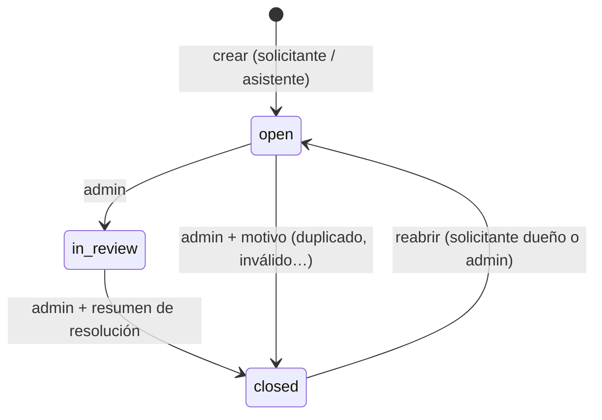
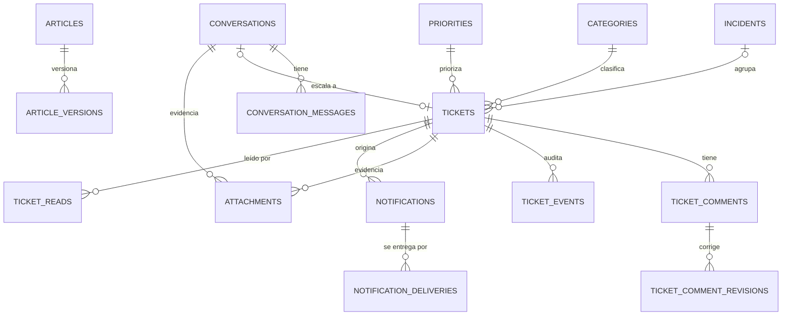

# Dominio

## Actores y roles

| Rol en el sistema | Quién es | Origen |
| --- | --- | --- |
| **Solicitante** | Cualquier cuenta autenticada: `agent`, `agency_owner`, `appeal_officer`. También un `admin` cuando abre sus propios casos | `onboarding.accounts` vía `reto.agents` |
| **Administrador de soporte** | Cuenta con `onboarding.accounts.role = 'admin'` | Ídem |

Supuestos documentados (§06):
- **Una sola organización autorizada (PBG).** Todo admin gestiona todos los tickets.
  Para soportar varias organizaciones bastaría agregar `organization_id` a
  `tickets` y filtrar por él; no está implementado.
- **La agencia no da acceso.** Un dueño de agencia o un agente solo ve sus propios
  tickets.
- **Los clientes de los agentes no usan el sistema.** No tienen cuenta y ningún flujo
  los contempla.

## Glosario

| Término | Definición |
| --- | --- |
| Conversación | Hilo de chat de un solicitante con el asistente. Se puede retomar y genera como máximo un ticket |
| Datos del caso | Área afectada, qué intentaba hacer, resultado esperado, error observado e impacto. Los extrae el asistente |
| Artículo | Problema conocido del catálogo. Tiene versiones inmutables y una de ellas está publicada |
| Incidente | Falla conocida todavía sin solución. Los tickets se pueden vincular a un incidente |
| Ticket | Caso escalado al equipo. Tiene número visible `TCK-000123` |
| Reporte original | Texto que escribió el usuario, sin cambios. Se guarda separado del resumen generado por IA |
| Comentario público | Lo ven el solicitante y los admins |
| Nota interna | La ven solo los admins. Nunca llega al solicitante, a una notificación ni al modelo |
| Evento | Registro de auditoría de solo inserción (estado, asignación, comentario, adjunto…) |
| Notificación | Aviso persistente para un destinatario. Tiene una entrega por canal |
| Entrega | Intento de hacer llegar una notificación por un canal (`in_app`, `email`), con estado `pending`, `delivered` o `failed` |
| Job | Tarea persistente que procesa el worker con reintentos |

## Estados del ticket (§05)

| Código | UI | Significado |
| --- | --- | --- |
| `open` | Abierto | Estado inicial, pendiente de que el equipo tome el caso |
| `in_review` | En revisión | Un admin investiga o atiende el caso |
| `closed` | Cerrado | Resuelto o cerrado con un motivo explícito |

Reglas:

1. Si el estado pedido es el actual, la API responde 200 sin cambios, sin evento y sin
   notificación, aunque la `version` enviada esté desactualizada (un doble clic no es
   un conflicto).
2. Cerrar exige `closure_reason`:
   - `resolved` exige además `resolution_summary`.
   - `duplicate` exige el ticket original: la API recibe `duplicate_of_number` y guarda
     `duplicate_of_ticket_id`.
   - `invalid`, `no_response` y `other` exigen `resolution_summary` como texto del
     motivo.
3. Cualquier otra transición (`in_review → open`, `closed → in_review`) responde 422
   `invalid_transition`.
4. Reabrir:
   - lleva a `open`, incrementa `reopened_count` y limpia `closed_at`;
   - conserva el historial completo;
   - exige un `reason` en texto;
   - notifica al solicitante y al equipo.
5. La IA nunca cambia estados. Solo un admin cambia estados, salvo la reapertura, que
   también puede hacer el solicitante dueño.
6. Asignación, prioridad, categoría y etiquetas son atributos aparte; no reemplazan
   los estados.
7. Cada mutación valida `version`. Si no coincide, responde 409 `version_conflict`
   con el ticket actual.

## Matriz de permisos

✔ permitido · ✖403 = se ve pero la acción está prohibida para el rol · 404 = no es
visible.

| Acción | Solicitante (propio) | Solicitante (ajeno) | Admin |
| --- | --- | --- | --- |
| Crear y continuar su conversación | ✔ | 404 | ✔ (las suyas) |
| Ver la conversación de origen de un ticket | ✔ | 404 | ✔ (solo lectura) |
| Crear ticket (chat o formulario) | ✔ | — | ✔ |
| Listar tickets | solo los suyos | — | todos |
| Ver detalle, historial y resolución | ✔ (sin notas internas) | 404 | ✔ |
| Comentario público | ✔ (Abierto o En revisión) | 404 | ✔ |
| Nota interna (crear o ver) | ✖403 al crear; nunca se listan | 404 | ✔ (también con el ticket cerrado) |
| Subir adjunto | ✔ (siempre público) | 404 | ✔ (público o interno) |
| Descargar adjunto público | ✔ | 404 | ✔ |
| Descargar adjunto interno | 404 | 404 | ✔ |
| Retirar adjunto | ✖403 | 404 | ✔ (queda trazabilidad) |
| Cambiar estado | ✖403 | 404 | ✔ |
| Reabrir ticket cerrado | ✔ | 404 | ✔ |
| Asignar, prioridad, categoría, etiquetas | ✖403 | 404 | ✔ |
| Leer artículos publicados | ✔ | — | ✔ |
| Ver borradores; crear, versionar, publicar o archivar artículos | ✖403 | — | ✔ |
| Gestionar incidentes | ✖403 | — | ✔ |
| Notificaciones: listar y marcar leídas | solo las suyas | 404 | solo las suyas |
| Métricas y configuración de prioridades | ✖403 | — | ✔ |

La versión para entregar es `docs/permisos.md` (spec 008). Los tests de integración
cubren cada fila con tres actores: dueño, otro usuario y admin.

## Modelo de datos (esquema `helpdesk`)

Las referencias a personas apuntan a `onboarding.accounts(id)` (tipo `text`). Las
fechas son `timestamptz` en UTC. El DDL detallado está en el `plan.md` de cada
feature.

| Tabla | Spec | Propósito |
| --- | --- | --- |
| `jobs` | 001 | Cola persistente del worker |
| `idempotency_keys` | 001 | Respuestas guardadas por `Idempotency-Key` |
| `categories`, `priorities` | 002 | Catálogos configurables |
| `tickets` | 002 | Caso; número visible por secuencia `ticket_number_seq` |
| `ticket_comments`, `ticket_comment_revisions` | 002 | Comentarios públicos o internos, con trazabilidad de ediciones |
| `ticket_events` | 002 | Auditoría de solo inserción |
| `ticket_reads` | 002 | Última lectura por usuario, para "sin leer" |
| `articles`, `article_versions`, `incidents` | 003 | Catálogo e incidentes |
| `conversations`, `conversation_messages` | 004 | Chat y su historial completo |
| `notifications`, `notification_deliveries` | 005 | Bandeja y entregas por canal |
| `attachments` | 006 | Metadatos; el binario va en S3 |

**Decisión:** no se reutiliza el esquema heredado `support.*`. Viene de SQLite:
fechas como `bigint`, JSON guardado como texto y `rowid`. Además el test
`database.test.mjs` exige que sus conteos no cambien. Se documenta en
`docs/adr/0001-helpdesk-schema.md`.

## Formatos

- Número visible: `TCK-` + 6 dígitos con ceros a la izquierda (`TCK-000042`). En la
  API se exponen tanto `number` (entero) como `display_number`.
- Enlace a un ticket: `${PUBLIC_APP_URL}/tickets/:id`. Abrirlo vuelve a verificar
  la sesión y los permisos.
- Fechas: ISO 8601 en UTC en la API. La UI las muestra en la zona horaria del
  navegador, en formato relativo ("hace 5 min") y absoluto en el tooltip.
